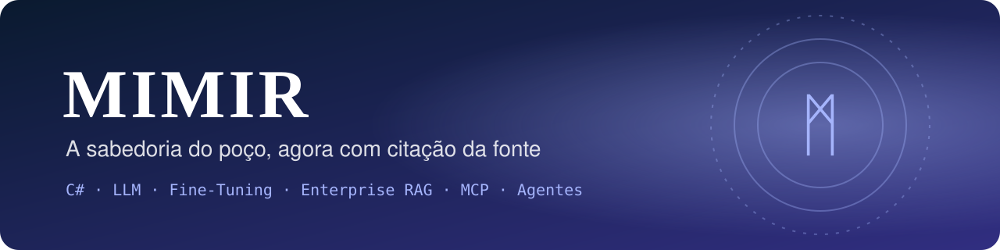
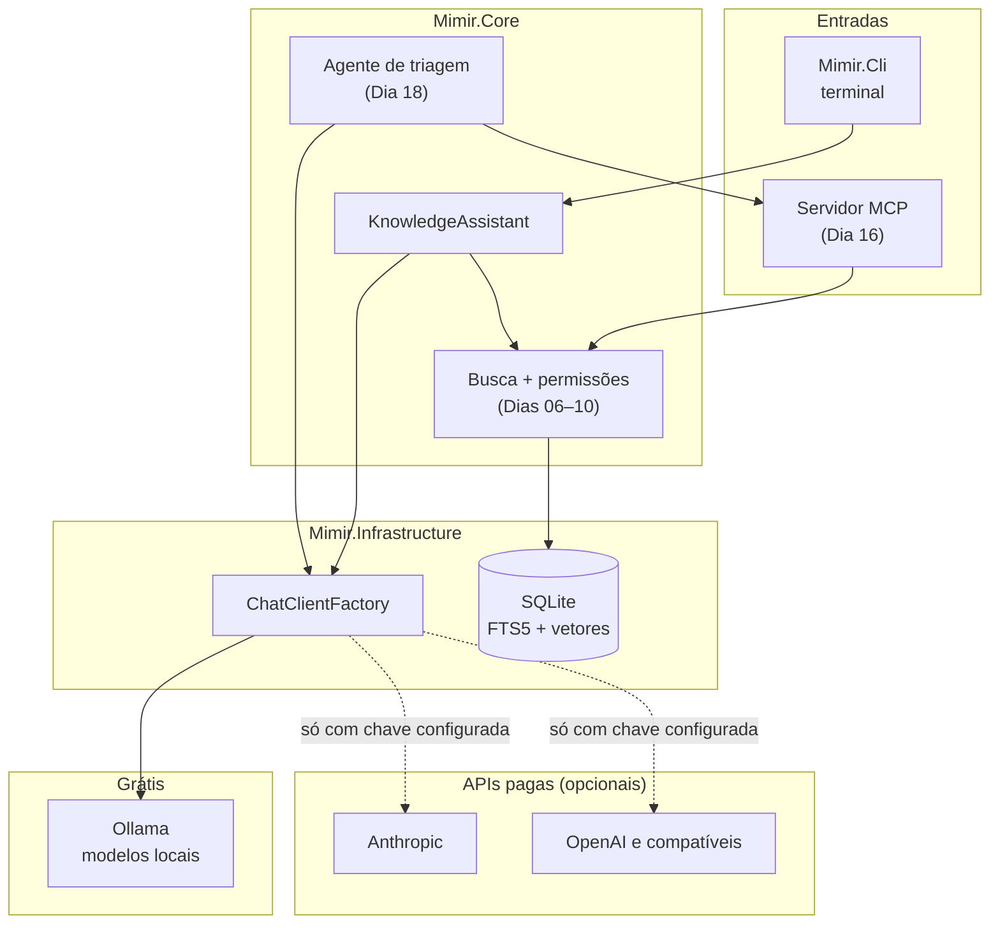

<div align="center">



# ᛗ Mimir
### A sabedoria do poço, agora com citação da fonte

**Assistente de conhecimento corporativo em C# / .NET 10, com IA que roda de graça na minha máquina.**
LLM, Fine-Tuning, Enterprise RAG, MCP e Agentes Autônomos no mesmo projeto,<br/>
com o código pronto para trocar o modelo local por uma API paga mudando só a configuração.

[](https://github.com/GustavoThe01/mimir-ai/actions/workflows/ci.yml)


</div>

---

## 👨‍💻 Autor

<table>
  <tr>
    <td width="62%">

Eu sou o **Gustavo Osterno Thé**. Idealizei, desenvolvo e mantenho o **Mimir**, o projeto de IA do meu portfólio público de Desenvolvedor Pleno. Ele é independente dos outros cinco projetos.

Defini duas regras para ele: **não gastar nada** para construí-lo e **não depender de nenhum fornecedor**. Por isso, tudo roda com modelos abertos e locais, e o núcleo do código não sabe qual modelo está por trás.

    </td>
    <td width="38%">

| | |
|---|---|
| 🌐 Site | [site-gustavothe-dev.web.app](https://site-gustavothe-dev.web.app/) |
| 💼 LinkedIn | [gustavoosterno](https://www.linkedin.com/in/gustavoosterno/) |
| 🐙 GitHub | [@GustavoThe01](https://github.com/GustavoThe01) |
| 📸 Instagram | [@gustavo.osterno](https://www.instagram.com/gustavo.osterno) |

    </td>
  </tr>
</table>

---

## 📑 Sumário

- [Os 5 conceitos de IA](#-os-5-conceitos-de-ia)
- [A origem do nome](#ᛗ-a-origem-do-nome)
- [O que o sistema vai fazer](#-o-que-o-sistema-vai-fazer)
- [Arquitetura](#️-arquitetura)
- [Como rodar de graça](#-como-rodar-de-graça)
- [Como usar APIs pagas](#-como-usar-apis-pagas)
- [Metodologias e decisões](#-metodologias-e-decisões)
- [Roadmap](#️-roadmap)
- [Testes](#-testes)
- [Estrutura do projeto](#-estrutura-do-projeto)
- [O que ainda falta](#-o-que-ainda-falta)

---

## 🧠 Os 5 conceitos de IA

> Só marco um conceito como ✅ quando ele tem código e testes neste repositório. O que ainda é plano aparece como ⏳, com o dia previsto.

| Conceito | Como vou aplicar | De graça | Situação |
|---|---|---|---|
| **LLM** | Responder perguntas através de uma interface única, com o provedor definido na configuração | Ollama + modelo aberto | 🟡 Já responde com modelo local e em streaming; saída estruturada e avaliação nos Dias 03–05 |
| **Enterprise RAG** | Responder com base nos documentos da empresa, citando a fonte e respeitando a permissão de quem pergunta | Embeddings locais + SQLite | ⏳ Dias 06–10 |
| **Fine-Tuning** | Treinar um modelo pequeno para classificar chamados por setor e medir o ganho contra o modelo sem ajuste | Script de treino em GPU local ou Google Colab gratuito | ⏳ Dias 11–15 |
| **MCP** | Expor a busca e os chamados como ferramentas, para qualquer cliente compatível usar | SDK oficial do MCP para C# | ⏳ Dias 16–17 |
| **Agentes Autônomos** | Agente que faz a triagem de um chamado consultando as ferramentas MCP, com limite de passos e aprovação humana | Modelo local com suporte a ferramentas | ⏳ Dias 18–19 |

### LLM: o núcleo não conhece o fornecedor

Fiz o primeiro teste real em uma GTX 1060 de 6 GB, usando modelos gratuitos do Ollama, com as mesmas 3 perguntas:

| Modelo | Tamanho | Velocidade medida | Classificou o chamado de TI? |
|---|---|:---:|:---:|
| `llama3.2:3b` (padrão) | 2,0 GB | 5,4 tokens/s | ✅ Sim |
| `llama3.2:1b` | 1,3 GB | 10,5 tokens/s | ❌ Não |

Escolhi o `llama3.2:3b`: ele é mais lento, mas acertou mais. Uma resposta curta levou cerca de 1 minuto, por isso a CLI mostra o texto em streaming. Esses modelos pequenos também erram: em um dos testes, o `llama3.2:3b` deu uma definição errada de livro-razão. É justamente esse problema que o RAG da semana 2 vai atacar, respondendo a partir de documentos e citando a fonte.

O núcleo depende só de `IChatClient`, a abstração do `Microsoft.Extensions.AI`. A classe [`ChatClientFactory`](src/Mimir.Infrastructure/Llm/ChatClientFactory.cs) é o único lugar que conhece os provedores. Registrei essa decisão no [ADR 0001](docs/adr/0001-provedor-de-llm-configuravel.md).

### Enterprise RAG: o que muda em relação a um RAG simples

- **Busca híbrida:** vetores para o significado e FTS5 para termos exatos, como códigos e siglas.
- **Permissão antes do modelo:** o documento que o usuário não pode ler é filtrado na busca e nunca chega ao prompt.
- **Citação obrigatória:** cada resposta aponta o trecho de origem. Sem fonte, a resposta é "não sei".
- **Avaliação:** um conjunto de perguntas com resposta esperada mede a qualidade a cada mudança.

### Fine-Tuning: só vale se o número provar

Comparo o modelo ajustado com o mesmo modelo usando apenas exemplos no prompt, nos mesmos dados de teste. O treino é a única parte em Python, porque o ecossistema de treino é todo nessa linguagem. O motivo está no [ADR 0002](docs/adr/0002-fine-tuning-em-python.md).

### MCP: ferramentas padronizadas

O servidor MCP expõe `search_knowledge`, `get_ticket` e `create_ticket`. As regras de permissão são as mesmas da aplicação: o protocolo não abre um caminho paralelo até os dados.

### Agentes Autônomos: autonomia com limite

Limite de passos, registro de cada decisão, aprovação humana para ações que alteram dados e o conteúdo dos documentos tratado como dado, nunca como instrução, para resistir a prompt injection.

---

## ᛗ A origem do nome

> *Na mitologia nórdica, Mímir é o guardião do poço da sabedoria. Odin entregou um dos olhos para beber dele e, depois da morte de Mímir, preservou sua cabeça para continuar a consultá-la.*

Escolhi o nome porque o sistema faz o que Odin fazia: consulta uma fonte de conhecimento antes de decidir. E o preço de Odin me lembra da minha regra de custo: aqui, a sabedoria não pode custar nada.

---

## ✨ O que o sistema vai fazer

Uma empresa fictícia tem políticas internas, manuais e chamados. Todos os documentos do repositório são inventados por mim.

| Módulo | O que resolve | Dia |
|---|---|:---:|
| 💬 **Perguntas** | Pergunta em linguagem natural pelo terminal, com resposta em streaming | ✅ 02 |
| 📚 **Base de conhecimento** | Importa documentos, divide em trechos e indexa | 06–08 |
| 🔐 **Permissões** | Cada documento tem os perfis que podem lê-lo | 10 |
| 🏷️ **Classificação** | Sugere o setor responsável por um chamado | 11–15 |
| 🔌 **Servidor MCP** | Ferramentas para clientes compatíveis | 16–17 |
| 🤖 **Agente de triagem** | Lê o chamado, pesquisa, propõe e pede aprovação | 18–19 |

---

## 🏛️ Arquitetura

Diagrama da arquitetura planejada. Hoje existem o `Mimir.Core`, a fábrica de provedores e a CLI.



---

## 🚀 Como rodar de graça

**Pré-requisito:** [.NET 10 SDK](https://dotnet.microsoft.com/download).

```bash
git clone https://github.com/GustavoThe01/mimir-ai.git
cd mimir-ai
dotnet test
```

**Sem instalar nenhum modelo**, com o provedor de teste, que não usa rede:

```bash
Llm__Provider=Fake dotnet run --project src/Mimir.Cli -- "Quantos dias de férias eu tenho?"
```

**Com um modelo real e local**, usando o [Ollama](https://ollama.com/), que é o padrão do projeto:

```bash
ollama pull llama3.2:3b
dotnet run --project src/Mimir.Cli -- "O que é um livro-razão?"
```

> Testei este caminho na minha máquina com uma GTX 1060 de 6 GB. A velocidade depende do seu hardware, e os modelos pequenos podem errar.

---

## 💳 Como usar APIs pagas

> **Nada aqui é necessário para rodar o projeto.** Não uso APIs pagas e não tenho custo com ele. Deixei este caminho pronto para quem quiser usar um modelo maior. As chamadas pagas são cobradas pelo fornecedor, então confira os preços antes.
>
> O código desses provedores compila e tem testes de configuração, mas **eu nunca o executei contra uma API real**, justamente para não gerar custo.

| Provedor | `Llm__Provider` | Variável da chave | `Llm__Model` |
|---|---|---|---|
| Ollama (grátis, padrão) | `Ollama` | não precisa | `llama3.2:3b` |
| [Anthropic](https://platform.claude.com/docs) | `Anthropic` | `ANTHROPIC_API_KEY` | `claude-haiku-5-5` (menor custo) ou `claude-opus-5-5` |
| [OpenAI](https://platform.openai.com/docs) | `OpenAI` | `OPENAI_API_KEY` | o modelo escolhido na documentação da OpenAI |
| Serviço compatível com a API da OpenAI | `OpenAI` + `Llm__Endpoint` | `OPENAI_API_KEY` | o modelo oferecido pelo serviço |

A chave fica sempre em variável de ambiente, nunca no código ou no `appsettings.json`.

**Bash:**

```bash
export ANTHROPIC_API_KEY="sua-chave"
export Llm__Provider="Anthropic"
export Llm__Model="claude-haiku-5-5"
dotnet run --project src/Mimir.Cli -- "Sua pergunta"
```

**PowerShell:**

```powershell
$env:ANTHROPIC_API_KEY = "sua-chave"
$env:Llm__Provider = "Anthropic"
$env:Llm__Model = "claude-haiku-5-5"
dotnet run --project src/Mimir.Cli -- "Sua pergunta"
```

### Fine-Tuning pago

O fine-tuning é o recurso que mais varia entre fornecedores. Este é o cenário que encontrei em novembro de 2026, em boa parte a partir de comparativos de terceiros, então **confirme na documentação oficial antes de contratar**:

| Opção | Situação |
|---|---|
| **Anthropic** | Sem fine-tuning na API direta. O caminho citado é o Amazon Bedrock, com um modelo Haiku antigo |
| **OpenAI** | [Encerrando o fine-tuning](https://www.developersdigest.tech/blog/openai-fine-tuning-shutdown-alternatives): segundo esse artigo, novos treinos param em janeiro de 2027 |
| **Google Vertex AI** | Oferece; a API do Gemini e o AI Studio [não oferecem](https://www.developersdigest.tech/models/fine-tuning) |
| **Amazon Bedrock e Microsoft Foundry** | [Oferecem](https://www.syncfusion.com/blogs/post/top-llm-api-comparison-2026), com variação por modelo |
| **Together AI, Fireworks AI** | [Treino de modelos abertos](https://www.developersdigest.tech/models/fine-tuning) como serviço |

O formato de dados de treino e a forma de usar o modelo ajustado no Mimir entram nesta seção no Dia 15. As opções pagas de embeddings entram no Dia 07.

---

## 🧭 Metodologias e decisões

- **Custo zero por padrão:** o provedor padrão é local, e os testes e o CI nunca chamam uma API paga.
- **Medir antes de afirmar:** RAG e fine-tuning só contam como melhoria com resultado em dados de teste.
- **Conventional Commits**, versionamento semântico e **ADRs**, como nos outros projetos.

| ADR | Decisão | Status |
|---|---|---|
| [0001](docs/adr/0001-provedor-de-llm-configuravel.md) | Provedor de LLM configurável, com Ollama como padrão | ✅ Aceita |
| [0002](docs/adr/0002-fine-tuning-em-python.md) | Treino de fine-tuning em Python, com o uso do modelo em C# | ✅ Aceita |

---

## 🗺️ Roadmap

| Semana | Dias | Conceito | Release | Progresso |
|---|---|---|:---:|---|
| 1 | 01–05 | LLM | `v0.1.0` | 🟪🟪⬜⬜⬜ |
| 2 | 06–10 | Enterprise RAG | `v0.2.0` | ⬜⬜⬜⬜⬜ |
| 3 | 11–15 | Fine-Tuning | `v0.3.0` | ⬜⬜⬜⬜⬜ |
| 4 | 16–20 | MCP e Agentes Autônomos | `v1.0.0` | ⬜⬜⬜⬜⬜ |

Detalhes no [ROADMAP.md](ROADMAP.md) · Mudanças no [CHANGELOG.md](CHANGELOG.md).

---

## 🧪 Testes

```bash
dotnet test
```

| Tipo | O que cobre | Situação |
|---|---|---|
| Unitários | `KnowledgeAssistant` e `ChatClientFactory`, sem rede e sem custo | ✅ 16 testes |
| Com modelo local | Resposta real pelo Ollama, conferida à mão e fora do CI | ✅ Feito no Dia 02 |
| Qualidade do RAG | Perguntas com resposta esperada | ⏳ Dia 10 |
| Segurança do agente | Limite de passos, aprovação e prompt injection | ⏳ Dia 19 |

---

## 📁 Estrutura do projeto

```
mimir-ai/
├── .github/workflows/ci.yml       # ✅ build e testes, sem custo
├── docs/
│   ├── adr/                       # ✅ decisões de arquitetura
│   └── assets/                    # ✅ banner
├── src/
│   ├── Mimir.Core/                # ✅ KnowledgeAssistant · ⏳ RAG e agente
│   ├── Mimir.Infrastructure/      # ✅ ChatClientFactory · ⏳ SQLite e vetores
│   └── Mimir.Cli/                 # ✅ perguntas pelo terminal
├── tests/Mimir.Tests/             # ✅ testes unitários
├── training/                      # ⏳ Dia 13 — fine-tuning em Python
├── Mimir.slnx
├── Directory.Packages.props       # ✅ versões centralizadas
├── CHANGELOG.md
└── ROADMAP.md
```

---

## 🧩 O que ainda falta

Mantenho aqui um checklist vivo do que ainda vou incrementar neste repositório.

**Projeto**
- [x] Solution, provedor configurável e CI (Dia 01)
- [x] Resposta real com Ollama e streaming (Dia 02)
- [ ] Prompts versionados, saída estruturada, avaliação e resiliência (Dias 03–05) → `v0.1.0`
- [ ] Enterprise RAG: ingestão, embeddings, busca híbrida, citações e permissões (Dias 06–10) → `v0.2.0`
- [ ] Fine-Tuning: dados, linha de base, treino, exportação e comparação (Dias 11–15) → `v0.3.0`
- [ ] Servidor MCP (Dias 16–17)
- [ ] Agente autônomo e testes de segurança (Dias 18–19)
- [ ] Demonstração e release (Dia 20) → `v1.0.0`

**README**
- [ ] GIF de uma pergunta com citação da fonte
- [ ] Tabela com os resultados reais do RAG e do fine-tuning
- [ ] Opções pagas de embeddings e de uso de modelo ajustado
- [ ] Atualizar a situação dos 5 conceitos a cada entrega
- [ ] Definir e adicionar uma licença (`LICENSE`)
- [ ] Versão em inglês do README

<div align="center">

<sub>Consultado por mim, antes de cada decisão · <a href="https://github.com/GustavoThe01">Gustavo Osterno Thé</a></sub>

</div>
